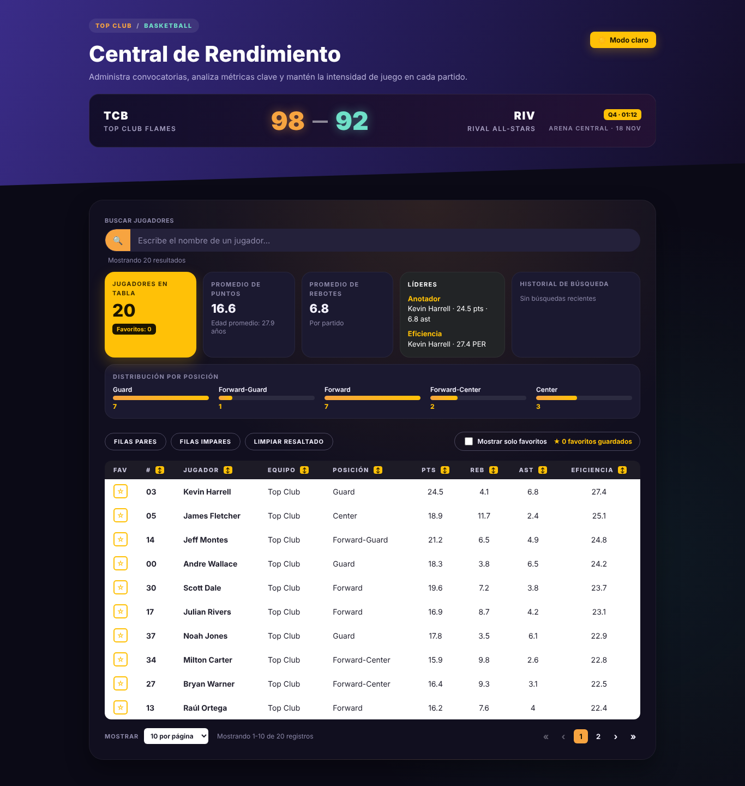
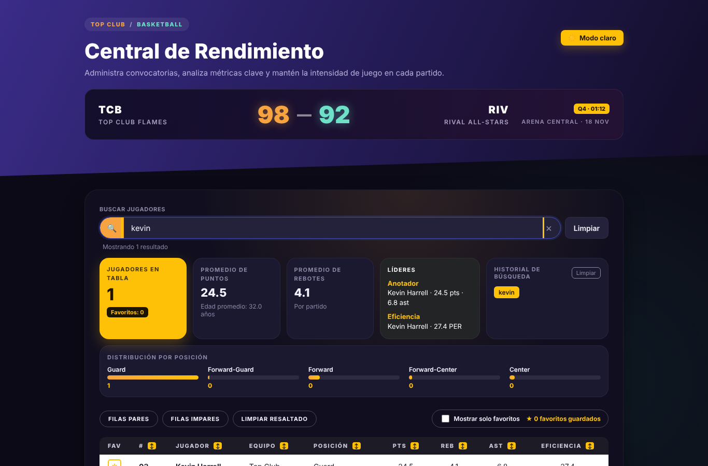
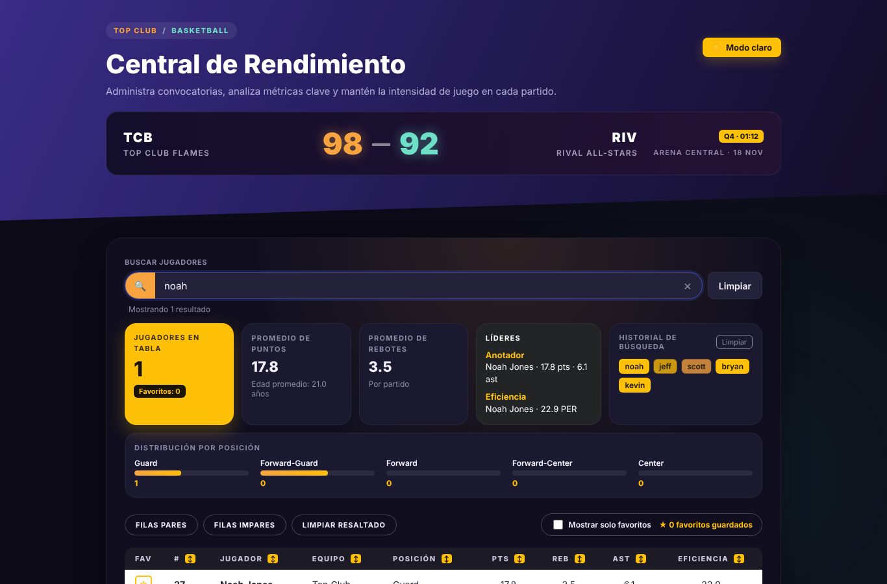
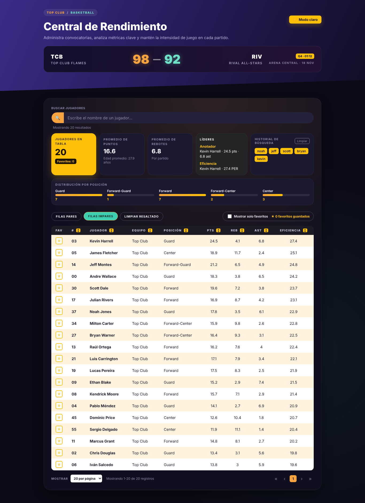
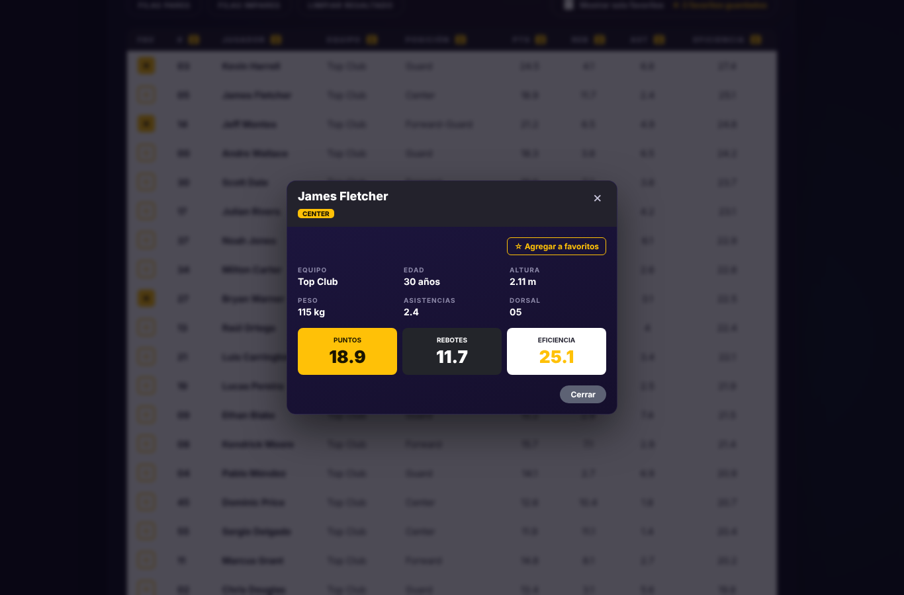
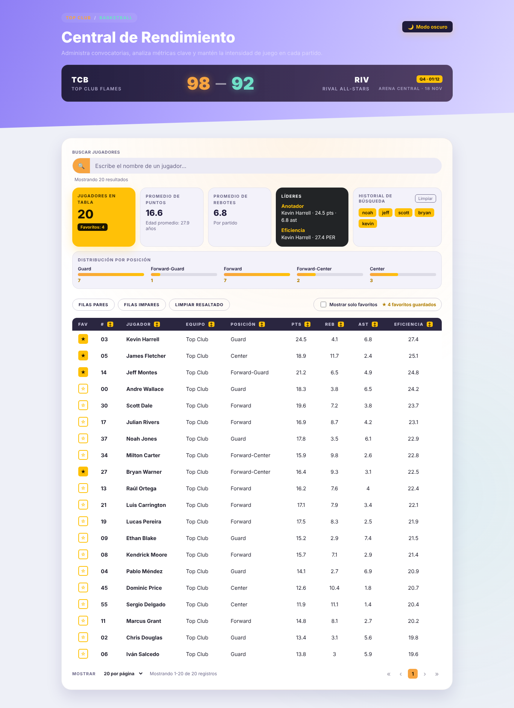
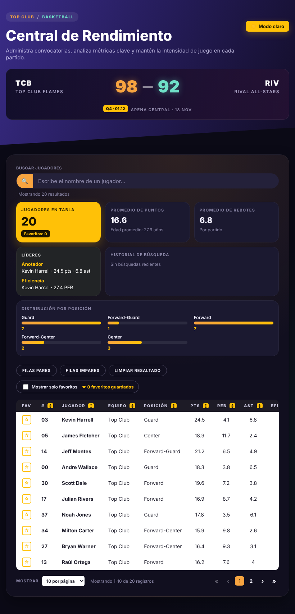
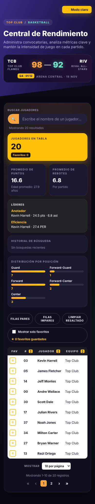

# 🏀 Central de Rendimiento · Top Club Basketball

Aplicación web en **React** para administrar la plantilla de basketball de **Top Club Flames**: búsqueda en tiempo real, ordenamiento por columnas, paginación, favoritos, estadísticas, historial de búsquedas y modo oscuro/claro. Proyecto final de **Programación 4**, Universidad de Manizales.

🔗 **Sitio publicado en Netlify:** https://basketball-stats-prog4.netlify.app

## 👥 Integrantes

| Integrante | Responsabilidad principal |
|---|---|
| Geraldine Herrera Rodríguez | Configuración, encabezado y tema, búsqueda con debounce, historial e integración en `App` |
| INTEGRANTE 2 | Tabla, filas, ordenamiento, resaltado de filas y paginación |
| INTEGRANTE 3 | Datos, estilos globales, estadísticas, modal, favoritos y `APRENDIZAJE.md` |

## 🤖 Uso de inteligencia artificial

Este proyecto se desarrolló con apoyo de **Claude (Anthropic), modelo Claude Opus 5.5**, como asistente para generar y revisar el código, los datos de ejemplo y la documentación. Los integrantes revisaron, probaron y adaptaron el resultado.

## ✨ Funcionalidades

| Funcionalidad | Hooks | Descripción |
|---|---|---|
| 🔍 Búsqueda con debounce | `useState`, `useEffect` | Filtra por nombre del jugador 300 ms después de dejar de escribir; muestra "Mostrando X resultados" y botones ✕ / Limpiar |
| 🎨 Resaltado de filas | `useState` | "Filas pares" (#e3f2fd), "Filas impares" (#fff3e0) y "Limpiar resaltado" con clases CSS condicionales |
| 📄 Paginación dinámica | `useState`, `useEffect` | 5, 10, 15 o 20 por página; « Primera, ‹ Anterior, números, Siguiente ›, Última »; "Mostrando X-Y de Z registros"; vuelve a la página 1 al filtrar |
| ↕️ Ordenamiento | `useState` | Clic en #, Jugador, Equipo, Posición, PTS, REB, AST o Eficiencia: sin ordenar (↕) → ascendente (↑) → descendente (↓) → sin ordenar |
| 🌓 Modo oscuro/claro | `useState`, `useEffect`, localStorage | Botón "Modo claro / Modo oscuro" que recuerda la preferencia |
| 📊 Estadísticas | `useMemo` | Jugadores en tabla, promedio de puntos, de rebotes y de edad, líderes (anotador y eficiencia) y barras por posición; se recalculan con los filtros |
| 🪟 Modal de detalles | `useState`, `useEffect` | Clic en una fila; cierra con ✕, "Cerrar", clic afuera o Escape; animación de entrada y salida; botón de favorito |
| ⭐ Favoritos | `useState`, `useEffect`, localStorage | Estrella ☆/★ por fila, filtro "Mostrar solo favoritos" y contador "X favoritos guardados" |
| 📜 Historial | `useState`, `useEffect`, localStorage | Últimas 5 búsquedas como etiquetas; un clic la restaura; botón "Limpiar" |

## 💿 Instalación

Requiere [Node.js](https://nodejs.org) 18 o superior.

```bash
git clone https://github.com/GeraldineOM/basketball-stats.git
cd basketball-stats
npm install
npm start
```

`npm start` abre el servidor de desarrollo en `http://localhost:5173`. Para generar la versión de producción:

```bash
npm run build     # crea la carpeta dist
npm run preview   # prueba la versión de producción
```

## 🎣 Hooks utilizados

| Hook | Dónde | Para qué |
|---|---|---|
| `useState` | `App`, `Modal` | Guardar datos que cambian: búsqueda, página, orden, favoritos, tema, modal abierto |
| `useEffect` con `[]` | `App` | Cargar favoritos e historial desde localStorage una sola vez al iniciar |
| `useEffect` con `[searchTerm]` y cleanup | `App` | Debounce de 300 ms; `clearTimeout` cancela el timer anterior |
| `useEffect` con `[darkMode]`, `[favorites]`, `[searchHistory]` | `App` | Guardar cambios en localStorage |
| `useEffect` con `[debouncedSearch, ...]` | `App` | Agregar al historial y volver a la página 1 cuando cambia un filtro |
| `useEffect` con cleanup | `Modal` | Animación de salida (`setTimeout`) y cierre con Escape (`removeEventListener`) |
| `useMemo` | `App` | Filtrar, ordenar y calcular estadísticas solo cuando cambian sus datos |

## 🗂️ Estructura

```text
basketball-stats/
├── index.html              # Metadatos: author, keywords, description
├── netlify.toml            # Configuración de despliegue
├── package.json
├── vite.config.js
├── docs/capturas/          # Capturas de pantalla
└── src/
    ├── main.jsx            # Punto de entrada
    ├── App.jsx             # Estado principal, efectos y composición
    ├── App.css
    ├── index.css           # Variables de tema (oscuro / claro)
    ├── data/players.js     # 20 jugadores de Top Club
    ├── utils/
    │   ├── players.js      # Ordenar, promedios, líderes, páginas, dorsal
    │   └── storage.js      # Lectura y escritura segura en localStorage
    └── components/
        ├── Hero.jsx              # Encabezado y marcador. Props: darkMode, onToggleTheme
        ├── ThemeToggle.jsx       # Props: darkMode, onToggle
        ├── SearchBar.jsx         # Props: value, onChange, onClear, resultsCount
        ├── SearchHistory.jsx     # Props: history, onSelectSearch, onClearHistory
        ├── StatsPanel.jsx        # Props: stats, favoritesCount, darkMode, children
        ├── RowColorControls.jsx  # Props: rowColors, onChange
        ├── FavoritesFilter.jsx   # Props: count, showOnlyFavorites, onToggle
        ├── PlayerTable.jsx       # Props: players, onRowClick, onSort, sortConfig, darkMode, rowColors
        ├── PlayerRow.jsx         # Props: player, index, onClick, isFavorite, onToggleFavorite, darkMode, colorClass
        ├── Pagination.jsx        # Props: currentPage, totalPages, onPageChange, itemsPerPage, onItemsPerPageChange, totalItems
        └── Modal.jsx             # Props: isOpen, onClose, player, darkMode, isFavorite, onToggleFavorite
```

Cada componente tiene su propio archivo `.css` con clases en **metodología BEM** (`bloque__elemento--modificador`), por ejemplo `player-row__star--active`, `stats-panel__card--highlight` o `scoreboard__points--home`.

**Arquitectura:** el estado vive en `App` y baja a los componentes por props; los componentes avisan los cambios con funciones (`onChange`, `onSort`, `onToggleFavorite`). `StatsPanel` recibe el historial como `children` (composición). Ningún componente supera las 200 líneas y las props bajan como máximo dos niveles (`App` → `PlayerTable` → `PlayerRow`).

## 📸 Capturas

| Vista general | Búsqueda |
|---|---|
|  |  |

| Historial | Filas impares resaltadas |
|---|---|
|  |  |

| Modal de detalles | Modo claro |
|---|---|
|  |  |

| Tablet | Celular |
|---|---|
|  |  |

## 🛠️ Tecnologías

React 18 · Vite 6 · CSS3 con BEM · localStorage · Netlify
